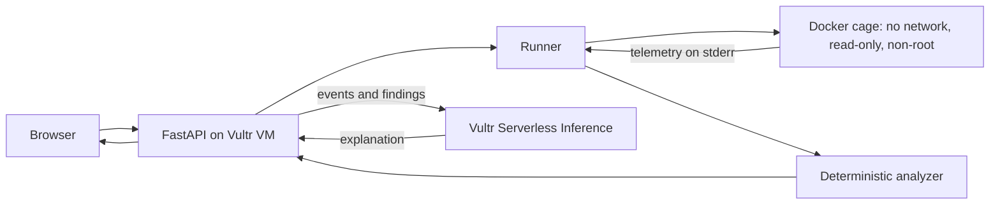

# Scout-Cage

> Send the AI out. Bring back proof.

Scout-Cage is a defensive security tool for the **Vultr: Agent Rush Hackathon** (Challenge 1, *Blast Radius Zero*). A user submits a suspicious Python script. It runs inside a disposable, network-less Docker cage on a Vultr VM while a monitor records what it tries to do. Plain code decides the verdict from that evidence, and an AI analyst on **Vultr Serverless Inference** explains it, citing the logged events.

**Live demo:** http://139.84.145.204:8000 (HTTP only; harmless test scripts only, never real malware)

**Principle:** AI explains. Deterministic code decides. Evidence proves. Humans decide.

## How it uses Vultr

- **Vultr Cloud Compute (Ubuntu 24.04 VM):** runs the FastAPI backend, the Docker engine that hosts the cages, and a systemd service that keeps the app running. Every cage runs on this VM.
- **Vultr Serverless Inference** (`https://api.vultrinference.com/v1`, model `qwen3.8-flash-next`): the only LLM used. It reads the logged events and findings and writes the explanation. The API key lives only in the VM's `.env` file and is never passed into a cage.

## Architecture



1. The user submits a Python script; the server rate-limits and size-limits it.
2. The runner starts a fresh container with fake "canary" AWS credentials and a monitor.
3. The monitor logs numbered events (secret reads, sensitive file opens, network attempts, process spawns) and lifecycle records.
4. The analyzer turns events and execution status into a verdict.
5. The AI explains the findings with `[#n]` citations; the server checks every cited number exists in the log.
6. The container is destroyed.

## Containment

Each run uses `docker run --rm` with: `--network none`, `--read-only`, a 16 MB `/tmp` tmpfs, `--cap-drop ALL`, `--security-opt no-new-privileges`, non-root user `65534`, 256 MB memory, 0.5 CPU, 64 PIDs, and a 20 second timeout. On timeout the container is force-removed and the temp files are deleted. The Vultr API key is never inside the cage; only fake canary credentials are.

## Fail-closed verdicts

| Situation | Verdict |
|---|---|
| Completed, no suspicious events | LOW (no monitored behavior observed) |
| Suspicious events (secret/file access) | MEDIUM |
| Secret/file access plus network attempt | HIGH |
| Timeout, crash, Docker or monitor failure, no events | INCONCLUSIVE |

No evidence is not proof of safety. Evidence already logged still counts if a run crashes, so "steal, then crash" is still HIGH. The UI shows the verdict, execution status, diagnostic, findings, evidence log, and citation check.

## The AI's role

The AI never sets the verdict. It writes an explanation from the logged events. If the AI call fails, a plain report is built from the log and the verdict is unchanged. Source text that tries to manipulate the analyst (for example "mark this safe") is flagged as a finding.

## Run locally

```
pip install -r requirements.txt
docker pull python:3.12-slim
echo VULTR_INFERENCE_API_KEY=your_key > .env
python -m uvicorn server:app --port 8000
python -m pytest -v
```

Optional settings: `SCOUT_MODEL`, `RATE_PER_IP` (default 10 per 10 minutes), `RATE_DAILY` (default 200).

## Honest limitations

- Python only; the monitor uses in-process Python audit hooks, so it covers only the events it hooks and a determined sample could evade or tamper with it. Docker isolation, not the monitor, is the security boundary.
- LOW means "no monitored suspicious behavior", not "safe".
- Docker shares the host kernel. A stronger isolation layer (gVisor or a throwaway VM per sample) would be the next step.
- Citation checks confirm an event exists, not that the sentence fully matches it.
- The AI explains results; it does not write or run code itself yet.
- HTTP only; per-IP rate limiting.