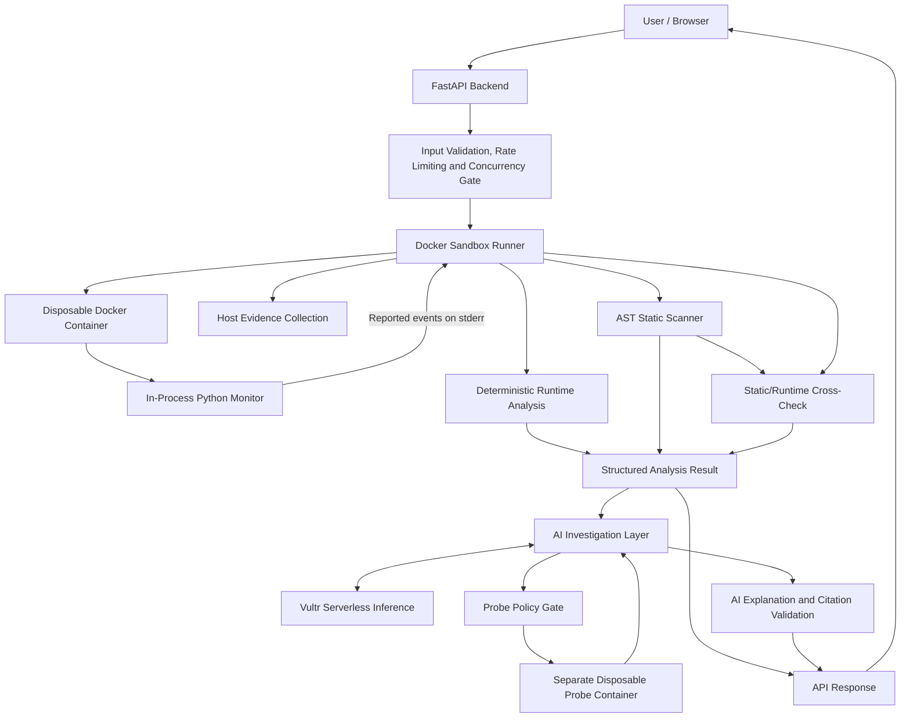

# Scout-Cage

> **Look before you run. Bring back reported observations, not guesses.**

Scout-Cage is a defensive Python security analysis and sandbox execution platform developed for the **Vultr: Agent Rush Hackathon — Challenge 1: Blast Radius Zero**.

It allows users to submit suspicious Python scripts for static security analysis and isolated execution inside disposable Docker containers. The system collects runtime observations, host-side evidence and resource outcomes, then uses AI to help explain potentially suspicious behavior.

Scout-Cage follows a security-first approach:

**AI explains. Deterministic code decides. Observations inform. Humans decide.**

**Published demo endpoint:** http://139.84.145.204:8000/

*This repository does not verify that the endpoint is currently available or document the VM's active overrides. The published endpoint uses HTTP. Use harmless test scripts only; never submit real malware, credentials or sensitive information.*

---

## 1. The Problem

Running an unfamiliar Python script can expose a system to several risks:

- Unauthorized access to environment variables and credentials.
- Sensitive file access.
- Unexpected network communication.
- Unwanted process creation.
- Resource exhaustion through excessive memory, CPU or process usage.
- Obfuscated code that hides potentially suspicious behavior.

Reading source code alone does not establish what a program actually does. Running it directly on a developer's machine can also introduce unnecessary risk.

Scout-Cage addresses this problem by combining static source analysis, Docker-based isolation, unverified runtime observations, best-effort host evidence collection and AI-assisted investigation.

## 2. The Solution

Scout-Cage provides a controlled environment where a submitted Python script can be inspected and executed under configured restrictions.

The system separates different types of information instead of treating every observation as proof.

It distinguishes:

1. **Static source indicators:** What potentially suspicious patterns are present in the submitted source code.
2. **Execution status:** Whether the container completed, timed out, failed or encountered a resource-limit event.
3. **Runtime observations:** What the in-process monitor reported during execution.
4. **Host-established evidence:** What Docker inspection and available host-side collection independently recorded. Collection can be incomplete or unavailable.
5. **AI investigation:** An explanation of the available findings and, when enabled, an additional generated probe.

These results are presented together without allowing AI-generated conclusions to override the deterministic verdict.

## 3. Key Features

### Static Security Analysis
- Uses Python's Abstract Syntax Tree (AST) to inspect submitted source code without executing it.
- Identifies suspicious network-related calls, process creation, dynamic execution, credential access and potentially hidden targets.
- Detects selected obfuscated strings through Base64 decoding.
- Assigns source-pattern risk levels: LOW, MEDIUM, HIGH or UNKNOWN.
- Reports the relevant source lines and indicator confidence.

### Docker-Based Sandbox
- Runs each submitted script inside a disposable Docker container.
- Disables network access.
- Uses a read-only container filesystem.
- Runs as a non-root user.
- Drops Linux capabilities.
- Applies memory, CPU, process and execution-time limits.
- Provides fake canary credentials rather than real secrets.
- Performs explicit host-side container inspection and cleanup.

### Runtime Monitoring
The in-process Python monitor uses audit hooks and additional environment-variable monitoring to report selected events, including:

- Fake credential environment-variable access.
- Sensitive file access.
- Network and DNS connection attempts.
- Process creation attempts.

Events are numbered so the AI report can reference them.

**Important:** These are unverified observations. Because the monitor shares a process with the submitted sample, a determined sample may forge, suppress or tamper with observations.

The monitor's lifecycle records are also in-process reports. They are not authenticated evidence that the sample actually performed a reported action.

### Host-Side Evidence Collection
The runner collects available information independently of the sample process, including:

- Docker container state.
- Container exit status.
- Docker-reported OOM information.
- Host-enforced timeout information.
- Available cgroup resource snapshots.
- Container cleanup status.
- Temporary-file cleanup status.

Missing information is reported as missing or incomplete evidence rather than being interpreted as zero.

### Resource Outcome Reporting
The application presents resource outcomes using:

- `STOPPED`
- `NOT_TRIGGERED`
- `UNKNOWN`

A resource limit is not reported as triggered without supporting evidence.

### AI-Assisted Investigation
Scout-Cage uses Vultr Serverless Inference to:

- Explain static source indicators.
- Interpret unverified runtime observations.
- Produce an investigation report.
- Generate a goal-aware Python probe when enabled.
- Explain probe output without allowing it to determine the security verdict.

### Citation Validation
AI reports can reference numbered monitor events using citations such as `[#1]`.

The backend checks whether cited event IDs exist in the collected event log and reports verified and invalid citations.

This validates the existence of an event ID, not the complete accuracy of the AI's explanation.

---

## 4. Technology Stack

| Component | Technology |
|---|---|
| Backend | Python, FastAPI |
| Frontend | HTML, CSS, JavaScript |
| Sandbox | Docker |
| Execution image | Python 3.12 Slim |
| Static analysis | Python AST |
| Runtime monitoring | Python audit hooks |
| AI integration | Vultr Serverless Inference |
| AI client | OpenAI-compatible Python client |
| Server | Uvicorn |

### AI Model

The application uses the Vultr Serverless Inference API:

`https://api.vultrinference.com/v1`

Default model:

`qwen3.8-flash-next`

The model can be changed through the `SCOUT_MODEL` environment variable.

The Vultr API key is configured on the backend and is not passed into the Docker cage.

---

## 5. Architecture



### Execution Flow

1. The user submits Python source code and an optional investigation goal.
2. The backend validates the input, applies request limits and checks concurrency.
3. The runner creates a disposable Docker container with configured isolation restrictions.
4. The monitor reports selected runtime observations, while the host collects available Docker and resource evidence.
5. The deterministic analyzer calculates the runtime verdict using the telemetry trust state.
6. The static scanner examines the source without executing it; static findings are then compared with reported runtime observations.
7. Prompt-injection source patterns are scanned and the AI investigation layer receives relevant findings and reported observations.
8. If enabled and the sample did not encounter a Docker failure, the AI generates a probe which passes through a policy check before execution in a separate disposable container.
9. The AI report is generated, citations are checked, and the structured result is returned to the frontend.

---

## 6. Sandbox Containment

Each submitted script runs with the following configured Docker restrictions:

| Setting | Configuration |
|---|---|
| Network | `--network none` |
| Memory | 256 MB |
| CPU | 0.5 CPU |
| Process limit | 64 PIDs |
| Filesystem | Read-only |
| Temporary storage | 16 MB `/tmp` tmpfs |
| Linux capabilities | All dropped |
| Privilege escalation | Disabled using `no-new-privileges` |
| Container user | Non-root UID/GID `65534:65534` |
| Main execution timeout | 20 seconds |
| Probe execution timeout | 10 seconds |

The container receives fake AWS canary credentials and a temporary working directory containing the submitted script and monitoring code.

No real AWS credentials or Vultr API credentials are intentionally placed inside the cage.

### Container Lifecycle

The runner:

1. Creates the container with a unique name.
2. Starts execution.
3. Collects available output and monitoring records.
4. Inspects Docker's container state before cleanup.
5. Collects available host-side evidence.
6. Explicitly removes the container.
7. Attempts to delete temporary host files.

Docker inspection and cleanup operations are bounded by timeouts. Failures are reported as incomplete evidence rather than silently treated as successful cleanup.

Docker isolation is a configured security boundary, not a guarantee of perfect containment.

---

## 7. Static Risk and Runtime Verdicts

Scout-Cage deliberately separates static source risk from the final runtime verdict.

### Static Risk

Static risk describes suspicious patterns found in the source code. It does not establish that a capability executed or that the author intended malicious behavior.

| Static Risk | Meaning |
|---|---|
| LOW | No supported suspicious indicators were identified. |
| MEDIUM | Medium-confidence source indicators were identified. |
| HIGH | At least one high-confidence source indicator was identified. |
| UNKNOWN | The source could not be analyzed reliably. |

The scanner uses selected AST patterns. It is not a complete malware detector and cannot identify every possible malicious technique.

**LOW does not mean safe.** It means this scanner did not identify supported suspicious patterns in the source it could analyze.

### Evidence Classes

- **Static source indicators** describe patterns found by source analysis. They do not prove that the code ran.
- **Unverified runtime observations** come from the in-process monitor and may be forged, suppressed or incomplete.
- **Host-established evidence** comes from Docker or host-side collection and is independent of the sample process, but collection can still be partial.
- **Unknown or unavailable evidence** means the system could not establish the relevant fact. It is not evidence that an event did not occur.

### Runtime Verdict

The runtime verdict is intentionally conservative.

The monitor executes inside the same process as the submitted sample. Its observations may be forged, suppressed or incomplete.

Therefore, the current implementation does not treat those observations as authenticated runtime evidence.

**At the current implementation baseline, `telemetry_trusted` is explicitly set to `False` by the runner. Consequently, normal runtime executions produce `INCONCLUSIVE`.**

This includes harmless scripts that complete successfully and suspicious scripts that produce HIGH static risk.

This does not mean that execution necessarily failed.

It means the available evidence is insufficient to establish an authenticated runtime conclusion.

### Reserved Authenticated Verdict Rules

The analyzer retains the following rules for a future execution path that can establish a trustworthy telemetry boundary:

| Authenticated Situation | Verdict |
|---|---|
| Completed execution with no suspicious findings | LOW |
| Suspicious findings without the HIGH combination | MEDIUM |
| Credential or sensitive-file access combined with a network attempt | HIGH |
| Timeout, crash, Docker failure, monitor failure or incomplete evidence | INCONCLUSIVE |

These authenticated rules are not currently active for normal executions.

**No evidence is not proof of safety.**

---

## 8. Resource Evidence and Limitations

Resource reporting is separate from static risk and the runtime verdict.

The runner uses Docker inspection and available host-side cgroup information to establish selected resource outcomes.

### Current Resource Reporting

| Resource | Current Evidence Approach |
|---|---|
| Network | UNKNOWN; in-process network observations are untrusted. |
| Execution time | STOPPED when the host runner enforces the timeout; otherwise UNKNOWN. |
| Memory | Docker OOM information and available cgroup counters. |
| Processes | cgroup PID-limit event counters when complete; otherwise UNKNOWN. |
| Scratch disk | UNKNOWN; independent host-side scratch-disk evidence is not implemented. |

A cgroup snapshot is collected on a best-effort basis.

The current implementation supports cgroup v2 snapshots and reports cgroup v1 paths as incomplete.

Short-lived containers may finish before a usable cgroup snapshot can be collected.

On Windows with Docker Desktop, the container runs inside a Linux environment, and the Windows host process does not normally have direct access to the container's Linux `/proc` and `/sys/fs/cgroup` paths. Therefore, cgroup evidence may be reported as `MISSING_EVIDENCE`.

Linux host collection still requires validation in the actual deployment environment. The application must not assume that cgroup evidence exists simply because Docker execution succeeded.

Missing evidence remains UNKNOWN or incomplete; it is never silently converted into zero.

---

## 9. AI Investigation and Probe Execution

Scout-Cage includes an AI-assisted investigation stage.

After the submitted sample has been executed and analyzed, the AI can receive:

- Submitted source code.
- Numbered runtime observations.
- Static findings.
- An optional user-provided investigation goal.

The goal input is limited to 500 characters.

### Probe Generation

The AI can generate a short Python probe to inspect the submitted source, such as decoding an obfuscated string or extracting a value.

The probe:

1. Is generated using the AI model.
2. Is checked by a Python AST-based policy gate.
3. Must use the supplied `SAMPLE_SOURCE`.
4. Is restricted to an allowlist of imports.
5. Cannot use selected dangerous calls such as `exec`, `eval` or `open`.
6. Cannot use double-underscore names or attributes.
7. Is executed in a separate disposable Docker container with the configured sandbox restrictions.
8. Has a 10-second execution timeout.

If the probe is rejected or execution fails, feedback can be sent to the AI for up to two additional attempts.

The policy gate is defense in depth. Docker containment remains the actual execution boundary.

### Important Current Limitation

The current implementation automatically generates and executes the probe when probing is enabled. There is no separate user approval stage before execution. A probe runs in a separate disposable Docker container; policy acceptance alone is not evidence that it executed.

The probe response preserves each generation cycle in `attempt_log`, including empty or malformed responses, policy decisions, execution-attempt state, confirmed-execution evidence when available, and sanitized execution outcomes. `attempts` counts generation cycles. Missing Docker start evidence remains unknown rather than being presented as confirmed execution.

The probe does not determine or override the main sample's runtime verdict.

---

## 10. Frontend

The frontend provides a single interface for submitting scripts and examining results.

Current interface functionality includes:

- Python source input.
- `.py` file upload.
- Optional investigation goal.
- Built-in demonstration samples.
- Containment lab scenarios.
- Deterministic verdict display.
- Execution status and diagnostics.
- Visual representation of reported observations.
- Static risk and source indicators.
- Static-to-runtime observation comparison.
- Resource containment receipt.
- Backend-provided investigation trace with stage statuses and evidence classifications.
- Individual probe attempts, including policy decisions and execution evidence state.
- Separate displays for static source indicators and unverified runtime observations.
- AI analyst report.
- Citation navigation and validation.
- AI probe status, generated code and output.

The investigation trace is presented after the response is received; it is not a live execution progress stream. Request validation, rate limiting and the concurrency gate happen in the API layer before `investigate()` and therefore are not stages in that trace. Older or incomplete responses are rendered with unavailable or unknown states where evidence is absent.

---

## 11. API

The FastAPI backend exposes:

| Method | Endpoint | Purpose |
|---|---|---|
| GET | `/` | Serves the Scout-Cage frontend. |
| POST | `/api/analyze` | Accepts a Python sample and returns its analysis. |

### Analysis Request

The request accepts:

- `code`: Python source code.
- `probe`: Whether AI probe generation is enabled; defaults to `true`.
- `goal`: Optional investigation goal, maximum 500 characters.

Example:

```json
{
  "code": "print('Hello from Scout Cage!')",
  "probe": true,
  "goal": "Check whether the script contains suspicious behavior."
}
```

### Backend Request Controls

- Maximum submitted source size: 20,000 characters (the server checks Python string length).
- Per-IP request rate limit: repository default 10 requests per 10 minutes.
- Daily request limit: repository default 200 requests per process-local day.
- Maximum two concurrent analysis operations.

Rate limits can be overridden with `RATE_PER_IP` and `RATE_DAILY`. The counters are in-memory and process-local; restarting the server clears them. The checked-in repository does not include deployment configuration that verifies whether a live VM overrides these defaults.

---

## 12. Deployment on Vultr

The project has a published demonstration endpoint:

http://139.84.145.204:8000/

The endpoint uses HTTP in the README's published URL. Current availability, VM operating system, service manager, and live environment overrides are not verifiable from the repository because deployment manifests and host configuration are not included. Do not submit sensitive information.

### Vultr Integration

Vultr Cloud Compute provides the host environment for the backend and Docker execution.

Vultr Serverless Inference provides the AI model used for investigation and explanations.

The inference API key is stored in the backend environment and is not passed into the sandbox containers.

---

## 13. Running Locally

### Prerequisites

- Python 3.10 or newer (recommended; application dependencies are listed in `requirements.txt`).
- Docker installed and running.
- Internet access to download the Docker image and use Vultr Serverless Inference.
- A Vultr Serverless Inference API key for AI reports and probe generation (without it, AI requests fail and the backend can produce its deterministic fallback report).

### Setup

Create and activate a virtual environment:

```powershell
python -m venv .venv
.venv\Scripts\Activate.ps1
```

Install application dependencies:

```powershell
python -m pip install -r requirements.txt
```

Pull the sandbox image:

```powershell
docker pull python:3.12-slim
```

Create a `.env` file in the project root:

```env
VULTR_INFERENCE_API_KEY=your_api_key_here
SCOUT_MODEL=qwen3.8-flash-next
```

Do not commit your actual `.env` file or expose API keys in source code.

Start the application:

```powershell
python -m uvicorn server:app --port 8000
```

Open:

http://127.0.0.1:8000/

### Running Tests

The test suite uses `pytest`, which is not currently included in `requirements.txt`.

Install it separately:

```powershell
python -m pip install pytest
```

Run the repository's unit and integration tests from the `tests` directory:

```powershell
python -m pytest tests -q
```

Some tests require a working Docker daemon and the sandbox image.

The root-level `test_inference.py` is a live inference smoke script, not a unit test: running it can make a real Vultr inference request and consume API quota. It is not included in the command above.

---

## 14. Environment Configuration

| Variable | Purpose | Default |
|---|---|---|
| `VULTR_INFERENCE_API_KEY` | Authentication for Vultr Serverless Inference | Required for AI calls |
| `SCOUT_MODEL` | AI model identifier | `qwen3.8-flash-next` |
| `RATE_PER_IP` | Maximum requests per IP per 10 minutes | `10` |
| `RATE_DAILY` | Maximum daily requests | `200` |

Rate limits use in-memory counters in each server process. The daily counter resets when the process-local date changes; it is not a durable or cross-instance quota. No live VM override values can be confirmed from the checked-in files.

---

## 15. Honest Limitations

Scout-Cage is a security research and demonstration project, not a production malware-analysis platform.

Current limitations include:

1. **Monitor trust:** The Python monitor runs inside the sample's process and can potentially be forged, suppressed or tampered with. Its events are unverified observations.
2. **Runtime verdict:** Normal runtime verdicts remain INCONCLUSIVE until a trustworthy telemetry boundary is established.
3. **Static analysis coverage:** AST scanning detects selected source patterns and cannot detect every malicious technique.
4. **Docker isolation:** Docker shares the host kernel. It is not equivalent to a dedicated virtual machine or a stronger isolation runtime.
5. **Cgroup evidence:** Collection depends on host environment, cgroup version, path availability and container lifetime.
6. **Resource reporting:** Network and scratch-disk outcomes do not currently have complete independent host-side evidence.
7. **AI reliability:** AI explanations and generated probes may be incomplete or incorrect. They do not establish security facts.
8. **Evidence availability:** Docker and cgroup evidence are best-effort. Missing, incomplete or contradictory evidence can leave a stage unavailable or inconclusive.
9. **Human approval:** The current probe execution flow does not include a separate user approval stage.
10. **Citation validation:** Citation checks verify event-ID existence, not whether the AI's explanation accurately represents the event.

Future improvements may include an authenticated out-of-process monitoring mechanism, stronger isolation using gVisor or disposable virtual machines, more complete resource evidence, and a user-approved AI probe execution workflow.

---

## 16. Current Development Status and Next Steps

This section describes the implementation state and planned improvements. Planned features must not be treated as already implemented.

### Implemented

- FastAPI backend and frontend.
- Docker-based Python execution.
- Static AST security analysis.
- In-process runtime monitoring.
- Fake canary credentials.
- Docker host-state inspection and cleanup.
- Best-effort cgroup v2 evidence collection.
- Conservative runtime verdict policy.
- Resource outcome classification.
- Vultr Serverless Inference integration.
- AI-generated goal-aware probe.
- Probe policy validation and execution.
- AI report generation and citation-ID validation.
- Structured backend investigation trace with evidence classifications and stage outcomes.
- Per-cycle probe attempt history, including policy and execution evidence.
- Frontend rendering of backend trace stages, attempt history, static findings and runtime observations.

### Remaining work and limitations

**A. User Approval Before Probe Execution**
- Separate probe generation from execution.
- Present generated code for user review.
- Require explicit user approval before executing generated code.
- Revalidate the probe on the backend before execution.
- Preserve the existing sandbox and verdict security boundaries.

**B. Evidence Trust Improvements**
- Investigate a trustworthy out-of-process telemetry architecture.
- Validate cgroup v2 collection on the Linux VM.
- Preserve INCONCLUSIVE when evidence cannot establish a trustworthy conclusion.

### Hackathon Submission Deliverables

The remaining presentation and demonstration work should include:

- A professional PowerPoint presentation explaining the problem, solution, architecture, implementation, security model, results and limitations.
- A short screen-recorded demonstration showing the actual working application, using narration or captions.
- Final verification that the README, deployed application, GitHub repository, tests and demo video describe the same implementation.

---

## 17. Project Principles

Scout-Cage is built around a few important principles:

- Never equate source-code patterns with proven execution.
- Never treat unverified monitor events as authenticated evidence.
- Never interpret missing evidence as proof of safety.
- Never allow AI-generated explanations to override deterministic security decisions.
- Never claim a resource limit was triggered without supporting evidence.
- Never claim perfect containment.
- Prefer an honest INCONCLUSIVE result over an unsupported security conclusion.

**Scout-Cage: Look before you run. AI explains. Observations inform. Humans decide.**
