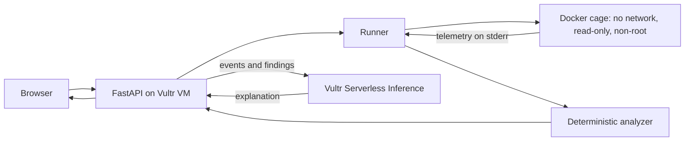

# Scout-Cage

> Send the AI out. Bring back proof.

Scout-Cage is a defensive security tool for the **Vultr: Agent Rush Hackathon** (Challenge 1, *Blast Radius Zero*). A user submits a suspicious Python script. It runs inside a disposable, network-less Docker cage on a Vultr VM while a monitor records reported observations about what it tries to do. Those observations are unverified and may be forged or incomplete, so runtime verdicts remain INCONCLUSIVE while telemetry is untrusted. An AI analyst on **Vultr Serverless Inference** explains the observations and static source indicators, citing the logged events where applicable.

**Live demo:** http://139.84.145.204:8000 (HTTP only; harmless test scripts only, never real malware)

**Principle:** AI explains. Deterministic code decides. Observations inform. Humans decide.

## How it uses Vultr

- **Vultr Cloud Compute (Ubuntu 24.04 VM):** runs the FastAPI backend, the Docker engine that hosts the cages, and a systemd service that keeps the app running. Every cage runs on this VM.
- **Vultr Serverless Inference** (`https://api.vultrinference.com/v1`, model `qwen3.8-flash-next`): the only LLM used. It reads the logged events and findings and writes the explanation. The API key lives only in the VM's `.env` file and is never passed into a cage.

## Architecture



1. The user submits a Python script; the server rate-limits and size-limits it.
2. The runner starts a fresh container with fake "canary" AWS credentials and a monitor.
3. The monitor logs numbered, unverified events (secret reads, sensitive file opens, network attempts, process spawns) and lifecycle records.
4. The analyzer combines execution status with the trust state of those observations. Untrusted telemetry cannot establish an authenticated runtime verdict.
5. The AI explains the findings with `[#n]` citations; the server checks every cited number exists in the log.
6. The container is destroyed.

## Containment

Each run uses `docker run` with explicit host-side inspection and cleanup, plus: `--network none`, `--read-only`, a 16 MB `/tmp` tmpfs, `--cap-drop ALL`, `--security-opt no-new-privileges`, non-root user `65534`, 256 MB memory, 0.5 CPU, 64 PIDs, and a 20 second timeout. The host inspects Docker state before force-removing the container, including Docker-reported OOM metadata where available. On timeout the container is force-removed and the temp files are deleted. The Vultr API key is never inside the cage; only fake canary credentials are.

## Fail-closed verdicts

The runtime verdict is deliberately conservative. Monitor events are unverified and may be forged or incomplete; while telemetry is untrusted, the runtime verdict is INCONCLUSIVE rather than LOW, MEDIUM, or HIGH. The authenticated verdict rules remain available for a future execution path that can establish a trustworthy telemetry boundary:

| Authenticated situation | Verdict |
|---|---|
| Completed, no suspicious events | LOW |
| Suspicious events (secret/file access) | MEDIUM |
| Secret/file access plus network attempt | HIGH |
| Timeout, crash, Docker or monitor failure, or incomplete evidence | INCONCLUSIVE |

No evidence is proof of safety. Static source analysis identifies source patterns, but does not prove that a capability executed. Resource outcomes are UNKNOWN unless supported by trustworthy host-side evidence. The UI shows the runtime verdict, execution status, diagnostics, static risk assessment, unverified observations, and citation check.

## The AI's role

The AI never sets the verdict. It writes an explanation from unverified runtime observations and static source indicators, and must not describe either as authenticated runtime evidence. If the AI call fails, a plain report is built from the log and the verdict is unchanged. Source text that tries to manipulate the analyst (for example "mark this safe") is flagged as a static source indicator.

## Run locally

```
pip install -r requirements.txt
docker pull python:3.12-slim
echo VULTR_INFERENCE_API_KEY=your_key > .env
python -m uvicorn server:app --port 8000
python -m pytest -v
```

Optional settings: `SCOUT_MODEL`, `RATE_PER_IP` (default 10 per 10 minutes), `RATE_DAILY` (default 200).

## Agent-written probe (Pattern A)

After the first run, the AI reads the sample's source and the logged events and writes one short Python probe (for example, to decode an obfuscated string). A policy gate checks it first: allowlisted imports only, and no exec, eval, open or double-underscore access. The probe then runs in the same cage, with the same limits and a 10 second timeout. If it fails or is rejected, the error is fed back to the AI for up to two more attempts. Its output is passed to the explanation and labelled (probe). The probe never changes the verdict, which is decided only from the sample's own run.

## Honest limitations

- Python only; the monitor uses in-process Python audit hooks, so it covers only the events it hooks and a determined sample could evade or tamper with it. Monitor events are therefore unverified observations, not authenticated proof of execution. Docker containment is a configured isolation boundary, not a claim of perfect security.
- Static risk describes source patterns only; it does not establish execution or intent.
- Resource outcomes remain UNKNOWN unless trustworthy host-side evidence establishes that a limit was reached or was not triggered. Short-lived containers can finish before a cgroup snapshot is captured; cgroup v1 controller paths are reported as incomplete unless safely established.
- Docker inspection and cleanup are bounded host operations. Inspection or cleanup failure is reported as incomplete evidence rather than treated as a clean run.
- While telemetry is untrusted, runtime verdicts remain INCONCLUSIVE rather than establishing LOW, MEDIUM, or HIGH.
- Docker shares the host kernel. A stronger isolation layer (gVisor or a throwaway VM per sample) would be the next step.
- Citation checks confirm an event exists, not that the sentence fully matches it.
- The probe gate is defense in depth only; the cage is the security boundary. A probe can fail or be skipped, and then the report is built without it.
- HTTP only; per-IP rate limiting.